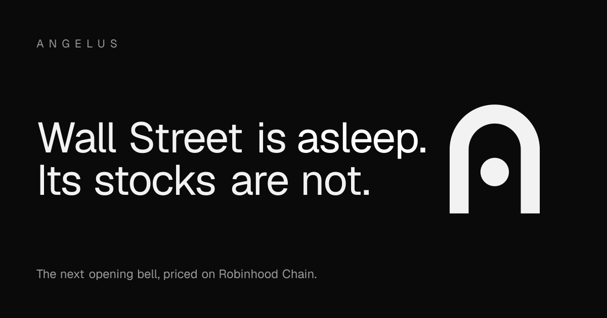

<a href="https://angelus-rho.vercel.app">
  
</a>

<h3 align="center">The stock market's night, priced.</h3>

<p align="center">
  An after-hours agent layer on Robinhood Chain that publishes where sixteen US stocks will open,<br>
  seals the estimate on-chain before the bell, and grades itself in public every morning.
</p>

<p align="center">
  <a href="https://angelus-rho.vercel.app"></a>
  <a href="https://robinhoodchain.blockscout.com/address/0x8c4dD82cB1560B3f4DC5293e2C159DeD2a5b9ccf"></a>
  
  <a href="https://angelus-rho.vercel.app/api/bell.json"></a>
  <a href="https://x.com/useangelus"></a>
</p>

<p align="center">
  <a href="https://angelus-rho.vercel.app/board"><b>Board</b></a> &nbsp;·&nbsp;
  <a href="https://angelus-rho.vercel.app/record"><b>Record</b></a> &nbsp;·&nbsp;
  <a href="https://angelus-rho.vercel.app/verify"><b>Verify</b></a> &nbsp;·&nbsp;
  <a href="https://angelus-rho.vercel.app/replay"><b>Replay</b></a> &nbsp;·&nbsp;
  <a href="https://angelus-rho.vercel.app/ledger"><b>Ledger</b></a> &nbsp;·&nbsp;
  <a href="https://angelus-rho.vercel.app/docs"><b>Method</b></a>
</p>

<br>

> [!NOTE]
> Wall Street trades six and a half hours a day. For the other seventeen and a half, its stocks keep trading as tokens on public blockchains. ANGELUS reads those hours and answers one question per stock, per night: **what will the official open be?** That number is **the Bell**.

<br>

## At a glance

<table>
  <tr>
    <td width="25%" valign="top"><b>16</b><br><sub>US stocks and ETFs, from NVDA to QQQ</sub></td>
    <td width="25%" valign="top"><b>3</b><br><sub>chains read: Robinhood Chain, Solana, Ethereum</sub></td>
    <td width="25%" valign="top"><b>04:00 ET</b><br><sub>the lock, sealed on-chain before the open</sub></td>
    <td width="25%" valign="top"><b>110.1 bp</b><br><sub>the Bell's average miss over 42 mornings</sub></td>
  </tr>
</table>

## Contents

- [How a night works](#how-a-night-works)
- [The agents](#the-agents)
- [Track record](#track-record)
- [Proof](#proof)
- [Coverage](#coverage)
- [Calls](#calls)
- [Open data](#open-data)
- [Architecture](#architecture)
- [Running locally](#running-locally)
- [Security](#security)
- [Disclaimer](#disclaimer)

## How a night works

| Time (ET) | Moment | What happens |
|:--|:--|:--|
| **16:00** | Closing bell | The exchange closes and the tokens keep trading. Every estimate starts to move, and calls open for the next morning. |
| **04:00** | The lock | Every number for the morning is frozen and published, and its digest is sealed on Robinhood Chain. Calls close. Wall Street's own pre-market has not begun, so the locked number is made from on-chain trading alone. |
| **09:30** | Opening bell | The official open settles every Bell. Each miss, in basis points of the open, goes on the public record. |

Nothing published at the lock can change afterwards, so every score is checked against numbers that were public before Wall Street opened. The three moments are also a [calendar feed](https://angelus-rho.vercel.app/calendar.ics).

## The agents

Three agents read the same night in different ways. The Bell blends them.

| Agent | Thesis | Method |
|:--|:--|:--|
| **Lauds** | Every chain is a witness. Ask all of them. | Takes the stock's price on all three chains, sets aside any chain that is too shallow or drifts more than 1% from the others, and averages the rest weighted by the square root of pool depth. |
| **Terce** | Most of a stock's night is the market's night. | Splits the move since the close into a market part, from the SPY token and the stock's 60-day beta, and a stock-specific part kept at half weight. |
| **Compline** | Night books misjudge the size of a move. Learn by how much. | Scales the Robinhood Chain move by the share of it that this stock's real opens have kept in the past. |
| **The Bell** | Trust each agent as much as it has earned. | Weights each agent by the inverse square of its recent error against real opens. An agent that misses more is heard less. |

Every formula is written out on the [Method](https://angelus-rho.vercel.app/docs) page and implemented in [`src/lib/agents.ts`](src/lib/agents.ts). A language model writes one or two sentences per stock at the lock (the Vigil). It writes words only and never sets or changes a number.

## Track record

42 mornings, September 22 to November 19, 2026. Average absolute miss against the official open, in basis points (lower is better):

| Estimate | Average miss | Right direction |
|:--|--:|--:|
| **The Bell** | **110.1 bp** | **71.8%** |
| Lauds | 110.6 bp | 70.4% |
| Robinhood Chain price alone | 111.7 bp | 71.0% |
| Compline | 113.7 bp | 69.9% |
| Terce | 121.1 bp | 69.9% |
| Opens where it closed | 148.8 bp | — |

Nights before ANGELUS went live are **replayed** from hourly pool history and official prices, using only data available before each night. Nights since launch are **locked live**. The record labels which is which, shows every miss on a heatmap, and keeps the nights the Bell lost. Current figures are always at [`/record`](https://angelus-rho.vercel.app/record) and in [`/api/bell.json`](https://angelus-rho.vercel.app/api/bell.json).

## Proof

ANGELUS is built so that nobody has to take its word for anything.

| | |
|:--|:--|
| **[Verify](https://angelus-rho.vercel.app/verify)** | Pick a night. The page rebuilds the seal's digest from the published numbers in your browser and compares it with the one stored on Robinhood Chain. |
| **[Ledger](https://angelus-rho.vercel.app/ledger)** | Every night ANGELUS has published: when it was locked, the seal transaction, and how it was graded at the open. |
| **[Replay](https://angelus-rho.vercel.app/replay)** | Any recent night played back half hour by half hour, from the closing bell through the lock to the grade at 09:30. |

### The seal

[`BellRegistry`](contracts/src/BellRegistry.sol) keeps one receipt per night on Robinhood Chain (chain ID 4663).

| | |
|:--|:--|
| **Address** | [`0x8c4dD82cB1560B3f4DC5293e2C159DeD2a5b9ccf`](https://robinhoodchain.blockscout.com/address/0x8c4dD82cB1560B3f4DC5293e2C159DeD2a5b9ccf), source verified |
| **Digest** | `keccak256(abi.encode(uint32 session, bytes8[] tickers, uint64[] closes, uint64[] bells))`, prices in USD with 6 decimals, tickers ascending |
| **Deadline** | Refuses any seal after 13:30 UTC on the session day, which is never later than the 09:30 ET open |
| **Rules** | One seal per night, only forward in time, no edit, no delete, holds no funds |
| **Roles** | A cold owner that can only rotate the keeper; a hot keeper on the server that seals at 04:00 ET |

To check a night without this site, read it straight from the chain:

```bash
cast call 0x8c4dD82cB1560B3f4DC5293e2C159DeD2a5b9ccf \
  "sealOf(uint32)((bytes32,uint64,uint16))" 20261119 \
  --rpc-url https://rpc.mainnet.chain.robinhood.com
```

and compare it with the digest of that night's numbers from [`/api/seals`](https://angelus-rho.vercel.app/api/seals). The contract is tested with Foundry:

```bash
cd contracts
forge install foundry-rs/forge-std --no-git
forge test          # 21 tests
```

## Coverage

**Sixteen stocks:** NVDA, TSLA, AAPL, MSFT, AMZN, META, GOOGL, AMD, PLTR, COIN, MSTR, CRCL, NFLX, AVGO, SPY, QQQ.

| Chain | Issuer | How it is read |
|:--|:--|:--|
| Robinhood Chain | Robinhood | Every pool, live from DexScreener |
| Solana | xStocks | Every pool, live from DexScreener |
| Ethereum | Ondo | Every pool, live from DexScreener |

Pools under $5,000 of depth are ignored, pools priced more than 30% from the official close are dropped as broken, and pools more than 3% from their chain's depth-weighted median are dropped as stale. Official daily opens and closes come from a public market-data feed; hourly history comes from GeckoTerminal.

## Calls

Anyone can call over or under the Bell on any of the sixteen opens, from the closing bell until 04:00 ET, by signing a plain-text message with a wallet. No transaction, no gas, no deposit and no prize. Calls are recorded once, cannot be edited, are settled by the official open, and appear on a public season table.

## Open data

No key, no account, CORS open. Please cache for at least a minute and credit ANGELUS.

| Endpoint | Returns |
|:--|:--|
| [`GET /api/bell.json`](https://angelus-rho.vercel.app/api/bell.json) | Tonight's Bell for every stock, each agent's estimate and weight, price and depth on every chain, and the record |
| [`GET /api/seals`](https://angelus-rho.vercel.app/api/seals) | Every on-chain seal: the exact numbers sent, the digest and the transaction |
| [`GET /api/health`](https://angelus-rho.vercel.app/api/health) | Status of the price sources, storage and the nightly lock |
| [`GET /edition/latest/image`](https://angelus-rho.vercel.app/edition/latest/image) | Tonight's edition as a 1600×900 PNG (`?s=2` for 3200×1800) |
| [`GET /calendar.ics`](https://angelus-rho.vercel.app/calendar.ics) | The close, the lock and the open as a weekday calendar in New York time |

```bash
curl -s https://angelus-rho.vercel.app/api/bell.json | jq '.stocks[] | {ticker, close, bell}'
```

## Architecture

```
src/
  app/              Pages (board, stock, record, verify, ledger, replay, calls, edition, watch, flow, method, token) and API routes
  components/       The 3D belfry (three.js), replay player, verify panel, heatmap, charts, call sheet, share cards
  lib/
    sources.ts      Every pool on three chains, with a last-good fallback when a source is down
    agents.ts       Lauds, Terce, Compline and the blend
    record.ts       How each morning is graded
    seal.ts         Building, sending and reading the nightly seal
    digest.ts       The seal digest, rebuilt exactly as the contract computes it
    replay.ts       A night rebuilt half hour by half hour from hourly history
    store.ts        Storage: Supabase in production, JSON files locally
contracts/          BellRegistry (Foundry): contract, tests, deploy script
supabase/           Schema (closed by RLS, reached only through token-checked functions) and the 04:00 ET cron
scripts/            Environment, database and smoke-test helpers
```

**Built with** Next.js 16 · React 19 · three.js · viem · WalletConnect · Supabase (Postgres, pg_cron, pg_net) · Foundry · Vercel

## Running locally

Requires Node.js 20.9 or newer.

```bash
npm install
npm run dev
```

No keys are needed. Prices come from public APIs, and calls and nightly locks are stored as JSON in `.data/`. Every optional variable is listed in [`.env.example`](.env.example).

| Command | Does |
|:--|:--|
| `npm run dev` | Development server |
| `npm run build` | Production build |
| `npm run lint` | ESLint |
| `node scripts/smoke.mjs <url>` | Checks every page, the health endpoint and that the bells are priced |

The full launch runbook (Supabase, Vercel, the exact-time cron, the on-chain seal and the production smoke test) is in [DEPLOY.md](DEPLOY.md).

## Security

- Database tables are closed to the public key by row-level security. The site reads and writes only through `angelus_*` SQL functions that check a server-side token. No service-role key is used anywhere.
- Calls are signatures over a plain message. ANGELUS never asks for a transaction, an approval or a private key.
- The keeper key can only seal the current night inside the contract's window. The owner, a cold wallet, can rotate it.
- Security headers (frame-ancestors, HSTS, nosniff, referrer and permissions policies) are set in [`next.config.ts`](next.config.ts).

## Disclaimer

ANGELUS publishes estimates, not investment advice. It is independent and not affiliated with, endorsed by or sponsored by Robinhood, Nasdaq, NYSE, any listed company or any token issuer. Company names, tickers and logos belong to their owners. See the [Terms](https://angelus-rho.vercel.app/terms).

<br>

<p align="center">
  <br>
  <sub>Built on Robinhood Chain · times in New York (ET)</sub>
</p>
